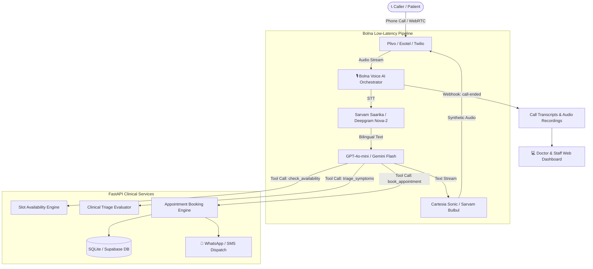

<div align="center">

# 🩺 AarogyaVoice (आरोग्यVoice)
### Autonomous Multilingual Clinical Triage & Clinic Receptionist Agent

**Built with Voice at Symphony by Bolna (YC F25)**  
*Bridging the 800M+ digital health divide in India through autonomous vernacular phone triage.*

[](https://www.bolna.ai)
[](https://fastapi.tiangolo.com)
[](https://opensource.org/licenses/MIT)
[](https://github.com/lavyadav182)

[Live Dashboard](#quickstart-run-locally) • [Architecture](#system-architecture) • [Clinical Triage Protocol](#clinical-triage-protocol) • [Bolna Agent Setup](#bolna-voice-agent-configuration) • [Submission Details](#bolna-buildathon-submission-metadata)

</div>

---

## 💡 The Real-World Problem
* **The Literacy & Digital Divide:** In India, over **800 million citizens** cannot navigate complex English-language smartphone apps like Practo or Apollo 24/7. When sick, in pain, or panicked, their only accessible interface is a direct telephone call.
* **Front-Desk Overwhelm:** Over **60% of inbound phone calls** to Tier-2/3 OPD clinics and community health centers go unanswered during peak hours.
* **Fatal Emergency Delays:** Understaffed receptionists cannot distinguish between a patient experiencing a life-threatening myocardial infarction (heart attack) and someone seeking a routine cough syrup refill.

---

## 🚀 The Solution: AarogyaVoice
**AarogyaVoice** is a production-grade, autonomous voice receptionist designed for clinics and hospitals:
1. **Zero App, Zero Internet Requirement for Patients:** Operates over ordinary telephone calls (PSTN via Plivo/Exotel/Twilio) and WebRTC.
2. **Indian Vernacular & Code-Switching:** Fluidly speaks and understands **Hindi, Hinglish, and English** with instant mid-sentence language adaptation.
3. **Evidence-Based Clinical Triage:** Evaluates symptoms against emergency protocols. Immediately flags `RED EMERGENCY` cases to summon 108 ambulances, while booking `URGENT` and `ROUTINE` cases into open doctor slots.
4. **Autonomous Tool Calling:** Real-time integration with clinic scheduling databases to verify doctor availability and reserve tokens.
5. **Instant WhatsApp / SMS Slip:** Fires a vernacular confirmation token with clinic address and Google Maps directions to the caller's mobile phone.

---

## 🏛️ System Architecture



---

## 🩺 Clinical Triage Protocol

AarogyaVoice implements strict safety guidelines to ensure patient emergencies are never delayed:

| Severity Level | Color | Symptom Profile | Autonomous Agent Action |
| :--- | :---: | :--- | :--- |
| **EMERGENCY** | 🔴 **RED** | Chest pain, heart palpitations, severe breathlessness, stroke signs, heavy bleeding, loss of consciousness. | Halts routine booking. Strongly commands patient to call **108 Ambulance** or reach casualty immediately. |
| **URGENT** | 🟡 **YELLOW** | High fever (>102°F) lasting >2 days, severe abdominal pain, persistent vomiting, pediatric distress. | Prioritizes same-day expedited OPD appointment with relevant specialist (Pediatrician / Physician). |
| **ROUTINE** | 🟢 **GREEN** | Mild cold, seasonal cough, chronic joint ache, prescription refill, blood pressure follow-up. | Books next standard outpatient slot and sends directions via WhatsApp. |

---

## ⚡ Quickstart: Run Locally

### 1. Clone the Repository
```bash
git clone https://github.com/lavyadav182/aarogya-voice.git
cd aarogya-voice
```

### 2. Install Dependencies
```bash
python -m pip install -r requirements.txt
```

### 3. Environment Configuration
Copy `.env.example` to `.env` and fill in your API keys (the project includes local fallbacks so it runs immediately even without keys):
```bash
copy .env.example .env
```

### 4. Launch the Platform
On Windows, simply run:
```bash
start.bat
```
Or run with Python directly:
```bash
python -m uvicorn backend.main:app --host 0.0.0.0 --port 8000 --reload
```

Open **`http://localhost:8000`** in your browser to access the **Doctor & Staff Web Dashboard** and interactive **Voice Agent Console**.

---

## 🎙️ Bolna Voice Agent Configuration

The repository includes ready-to-deploy configurations for the Bolna platform:
* **`bolna_agent/agent_config.json`**: Complete Bolna agent manifest specifying audio formats, Deepgram/Sarvam STT, Cartesia TTS, and API function tools.
* **`bolna_agent/system_prompt.txt`**: Empathetic clinical receptionist prompt with vernacular code-switching rules.
* **`bolna_agent/bolna_manager.py`**: Automated provisioning CLI:

```bash
# Create the agent on Bolna Cloud
python bolna_agent/bolna_manager.py create

# Trigger an outbound phone call test
python bolna_agent/bolna_manager.py call --phone +919876543210

# Export compiled JSON payload for Bolna Web Studio
python bolna_agent/bolna_manager.py export
```

---

## 📂 Repository Structure

```
aarogya-voice/
├── README.md                          # Hackathon & YC-caliber documentation
├── requirements.txt                   # FastAPI, Uvicorn, Pydantic, HTTPX
├── .env.example                       # API key definitions with acquisition links
├── start.bat                          # One-click startup script for Windows
├── bolna_agent/
│   ├── agent_config.json              # Bolna agent specification schema
│   ├── system_prompt.txt              # Multilingual clinical prompt
│   ├── bolna_manager.py               # Bolna API provisioning CLI
│   └── test_agent_simulator.py        # Terminal-based conversational harness
├── backend/
│   ├── main.py                        # FastAPI application & simulator endpoint
│   ├── config.py                      # Clinic settings & environment loader
│   ├── database.py                    # SQLite persistence & schema definitions
│   ├── seed_data.py                   # Initial doctor profiles & appointments
│   └── routers/
│       ├── triage.py                  # Clinical symptom evaluation engine
│       ├── appointments.py            # Slot availability & booking handlers
│       ├── webhooks.py                # Bolna post-call & recording webhook
│       └── notifications.py           # WhatsApp outbox & dispatch service
├── frontend/
│   ├── index.html                     # Live clinic dashboard & voice console
│   ├── app.js                         # Polling & browser speech synthesis
│   └── styles.css                     # Healthcare theme & waveform styling
├── docs/
│   ├── PITCH_DECK_SLIDES.md           # 7-Slide YC Pitch Deck
│   ├── DEMO_VIDEO_SCRIPT.md           # 2-Minute Demo Video Walkthrough
│   └── SUBMISSION_METADATA.md         # Validated portal submission fields
└── tests/
    └── test_flow.py                   # Local automated unit test suite
```

---

## 📝 Bolna Buildathon Submission Metadata

Validated strictly against the official Bolna Buildathon portal constraints:
* **Project Name:** `AarogyaVoice`
* **Short Description (183 chars, <200 chars limit):**
  > *AarogyaVoice is an autonomous multilingual voice receptionist for clinics that handles phone triage, live OPD slot booking, and WhatsApp confirmations in vernacular Indian languages.*
* **Submission Link:** `https://github.com/lavyadav182/aarogya-voice`
* **Pitch Deck / Video:** Host on Google Drive or Luma (ensure link sharing is set to *Anyone with link*).

---

## 👨‍💻 Author & Acknowledgments

* **Built by:** [Lav Yadav](https://github.com/lavyadav182)
* **Organized by:** [Bolna AI](https://www.bolna.ai) for **Symphony — India's Flagship Voice AI Summit**
* Special thanks to the Symphony sponsor ecosystem: Sarvam AI, Deepgram, Cartesia, Plivo, and Y Combinator.
